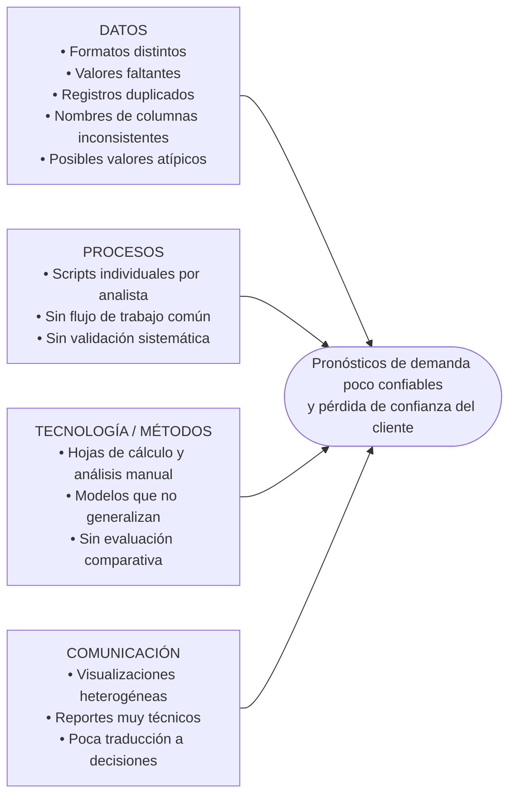

# Actividad 1. Diagnóstico del reto analítico y respuesta a la pregunta detonante

**Caso:** Predicciones bajo presión: el desafío analítico de Lumina Datos Operativos
**Programa:** Maestría en Inteligencia Artificial
**Alumno:** _[Nombre completo]_
**Matrícula:** _[Matrícula]_
**Profesor:** _[Nombre del profesor]_
**Fecha:** _[Fecha de entrega]_

---

## 1. Introducción

Muchas organizaciones ya tienen datos, pero eso no basta para tomar buenas decisiones. Las empresas medianas en particular suelen tener información de ventas, inventarios y clientes que está dispersa, es inconsistente o se analiza de forma manual. Con eso pueden explicar lo que ya pasó, pero no anticipar lo que va a pasar.

Este informe es el primer avance del proyecto, desarrollado con la metodología de aprendizaje basado en proyectos. Asumo el papel de un consultor analítico que debe entender una necesidad real de negocio antes de proponer una solución técnica. El objetivo es diagnosticar el caso de Lumina Datos Operativos: describir su contexto, identificar las necesidades de los actores, delimitar la problemática central y señalar las oportunidades de mejora en el uso de datos, la programación en Python y el análisis predictivo. Al final se da una primera respuesta a la pregunta detonante del reto.

## 2. Contexto de la organización

Lumina Datos Operativos es una firma mexicana de consultoría analítica. Ayuda a empresas medianas a interpretar su información comercial, operativa y de clientes. En sus primeros años se dedicó a hacer **reportes descriptivos** con hojas de cálculo, datos históricos y análisis manuales. Ese modelo funcionaba mientras los clientes solo querían saber *qué había ocurrido* con sus ventas o inventarios.

El mercado cambió. Ahora los clientes preguntan *qué podría ocurrir* y *qué decisiones conviene tomar* antes de que un problema salga caro. En términos de madurez analítica, esto es pasar de la analítica descriptiva a la **predictiva y prescriptiva** (Davenport y Harris, 2017).

La situación se volvió crítica con **Red Comercial Boreal**, una cadena regional de tiendas y uno de los clientes principales de Lumina. Boreal reportó diferencias importantes entre la demanda esperada y la demanda real de varios productos. Algunas sucursales acumularon inventario que no se vendió a tiempo, mientras que en temporadas de alta demanda hubo desabasto. Boreal necesita decidir qué productos priorizar, qué segmentos de clientes atender y cómo planear su próxima campaña, y empieza a perder la confianza en Lumina.

Ante esto, **Sofía Aranda**, directora de proyectos analíticos de Lumina, propone construir una **librería interna en Python** que organice todo el flujo de *machine learning* de forma modular, verificable y reutilizable.

## 3. Identificación de necesidades

| Actor | Necesidad | Evidencia en el caso |
|---|---|---|
| **Red Comercial Boreal (cliente)** | Pronósticos de demanda confiables para planear inventarios y campañas | Diferencias entre demanda esperada y real; inventario sin vender y desabasto |
| | Resultados que puedan entender quienes toman decisiones de negocio | Los reportes técnicos son difíciles de interpretar para los responsables de negocio |
| | Criterios claros para priorizar productos y segmentos | Necesita decidir qué productos priorizar y qué segmentos atender |
| **Lumina (dirección)** | Recuperar y conservar la confianza de un cliente clave | Riesgo de que Boreal busque un proveedor con mayor madurez analítica |
| | Ofrecer servicios predictivos además de los descriptivos | El mercado ya pide anticipar escenarios, no solo explicar el pasado |
| **Lumina (equipo de analistas)** | Un proceso común, reproducible y comparable | Cada analista usa sus propios scripts y criterios |
| | Herramientas reutilizables de limpieza, modelado y evaluación | Los modelos funcionan con un conjunto de datos y fallan con otro |
| | Formatos estándar de visualización y reporte | Las visualizaciones no siguen una estructura común |

## 4. Problemática central

### 4.1 Enunciado del problema

> **Lumina Datos Operativos no tiene un proceso analítico estandarizado, reproducible y orientado al negocio para convertir los datos desordenados de sus clientes en pronósticos confiables. Por eso Red Comercial Boreal toma malas decisiones de inventario y Lumina corre el riesgo de perder a uno de sus clientes principales.**

### 4.2 Análisis de causas

Para ordenar las causas uso un enfoque de causa-efecto (diagrama de Ishikawa) con cuatro categorías:

1. **Calidad de los datos.** La información de Boreal (ventas, categorías, precios, promociones, comportamiento de compra y variables operativas) llega en formatos distintos y con valores faltantes, duplicados, nombres de columnas inconsistentes y posibles valores atípicos. Cualquier modelo que se entrene con datos así arrastra esos errores ("*garbage in, garbage out*").
2. **Falta de estandarización en los procesos.** Cada analista resuelve el problema con sus propios scripts y criterios. Sin un flujo común, los resultados no se pueden reproducir ni comparar, y no queda registro de las decisiones técnicas.
3. **Debilidad metodológica en el modelado.** Hay modelos que rinden bien con un conjunto de datos y fallan con otro. Esto apunta a sobreajuste o a falta de validación adecuada, como la validación cruzada o la separación correcta entre datos de entrenamiento y de prueba.
4. **Comunicación deficiente de los resultados.** Las visualizaciones no siguen una estructura común y los reportes son difíciles de interpretar para el negocio. Así, el trabajo técnico no se traduce en decisiones.

### 4.3 Consecuencias

- **Para el cliente:** inventario sin vender, desabasto en temporada alta, costos de almacenamiento, ventas perdidas y campañas mal enfocadas.
- **Para Lumina:** menos credibilidad, riesgo de perder a un cliente estratégico y desventaja frente a consultoras con más madurez analítica.
- **Para el equipo:** trabajo duplicado, dependencia de cada persona y dificultad para incorporar a nuevos analistas.

## 5. Oportunidades de mejora

### 5.1 Uso de datos

- **Gobierno y calidad de datos:** definir un esquema estándar de columnas, tipos y formatos, y reglas automáticas para tratar faltantes, duplicados y valores atípicos.
- **Aprovechar variables ya disponibles:** los precios, promociones y el comportamiento de compra explican la demanda y pueden usarse como variables predictoras (*feature engineering*), por ejemplo para medir el efecto de las promociones o la estacionalidad.
- **Trazabilidad:** registrar cada transformación aplicada a los datos para poder auditar y reproducir los resultados.

### 5.2 Programación en Python

Python es un lenguaje de propósito general, fácil de aprender y con miles de bibliotecas para trabajar con datos. Es el estándar entre científicos de datos, ingenieros de datos e investigadores de IA, y sirve tanto para prototipos rápidos como para proyectos complejos (McKinney, 2022). Para Lumina, esto permite:

- Pasar de hojas de cálculo y scripts sueltos a una **librería modular** organizada en **funciones, clases y módulos reutilizables**.
- Usar bibliotecas especializadas y probadas:
  - **pandas** para cargar, limpiar y transformar los datos (McKinney, 2022).
  - **Matplotlib** y **Seaborn** para visualizaciones exploratorias con un estilo común (Hunter, 2007; Waskom, 2021).
  - **scikit-learn** para entrenar, validar y comparar modelos con una interfaz consistente (Pedregosa et al., 2011).
- Aplicar buenas prácticas de ingeniería de software: control de versiones con Git, pruebas y documentación. Eso facilita que el equipo colabore y que la solución crezca.

Una posible arquitectura para la librería es:

| Módulo | Responsabilidad |
|---|---|
| `carga` | Leer archivos de distintas fuentes y formatos y unificar el esquema |
| `limpieza` | Tratar faltantes, duplicados, valores atípicos y nombres de columnas |
| `exploracion` | Estadística descriptiva y visualizaciones estandarizadas |
| `preprocesamiento` | Codificación, escalamiento y creación de variables |
| `modelos` | Modelos supervisados (regresión para pronosticar demanda) y no supervisados (*clustering* para segmentar clientes o productos) |
| `evaluacion` | Validación cruzada, métricas (MAE, RMSE, R², silueta) y comparación entre modelos |
| `reportes` | Resultados para público técnico y para público de negocio |

### 5.3 Análisis predictivo

- **Modelos supervisados** para pronosticar la demanda por producto, categoría o sucursal, comparando alternativas como la regresión lineal, los árboles de decisión y *random forest* contra un modelo de referencia (*baseline*).
- **Modelos no supervisados** para segmentar clientes y productos (por ejemplo, con *k-means*), lo que responde a la pregunta de Boreal sobre qué segmentos atender.
- **Validación estadística rigurosa** con validación cruzada, conjuntos de prueba independientes y métricas adecuadas, para evitar el sobreajuste y justificar cada decisión técnica con evidencia.
- **Comunicación orientada a decisiones:** traducir las métricas a consecuencias de negocio, como unidades de sobreinventario evitadas o productos que conviene priorizar (Provost y Fawcett, 2013).

## 6. Respuesta inicial a la pregunta detonante

> **¿Cómo puede un framework modular de machine learning en Python transformar datos empresariales desordenados en análisis predictivos confiables para apoyar decisiones estratégicas?**

Un *framework* modular de *machine learning* en Python logra esa transformación de cuatro maneras.

1. **Estandariza la calidad de los datos desde el inicio.** Los módulos de carga y limpieza aplican las mismas reglas cada vez: unifican formatos y nombres de columnas y tratan los faltantes, duplicados y valores atípicos. Así los datos desordenados se vuelven una base confiable y comparable entre proyectos.
2. **Hace reproducible y verificable el análisis.** Las funciones y clases reutilizables sustituyen a los scripts individuales. Cualquier analista puede repetir el mismo flujo y obtener los mismos resultados, y cada transformación y decisión queda documentada.
3. **Da rigor estadístico al modelado.** La evaluación comparativa y la validación cruzada permiten elegir modelos por evidencia y no por intuición. También muestran si un modelo generaliza a datos nuevos, que es justo el problema que hoy tiene Lumina.
4. **Conecta los resultados técnicos con las decisiones de negocio.** Un módulo de reportes con visualizaciones estandarizadas traduce las métricas y predicciones a información útil para Boreal: qué productos priorizar, qué segmentos atender y cuánto inventario planear.

El valor del *framework* no está en prometer predicciones perfectas. Está en **reducir la improvisación, asegurar la trazabilidad y dar a las decisiones un respaldo técnico** que el cliente pueda entender y en el que pueda confiar. Si Lumina consigue equilibrar la precisión técnica, la claridad del diseño y la utilidad para el negocio, podrá recuperar la confianza de Red Comercial Boreal y dar el salto de la analítica descriptiva a la predictiva.

## 7. Conclusiones

- El problema de Lumina no es solo técnico. También es de **procesos y de comunicación**: los datos de mala calidad, el trabajo sin estándares y los reportes difíciles de interpretar se refuerzan entre sí y producen pronósticos poco confiables.
- La necesidad más urgente es **estandarizar el flujo analítico completo**, no simplemente buscar un modelo más complejo.
- Python y su ecosistema (pandas, Matplotlib, Seaborn, scikit-learn) son una base madura y adecuada para construir una librería modular, reutilizable y verificable.
- Las siguientes etapas del proyecto deberán diseñar la arquitectura de la librería, implementar sus módulos y probarlos con datos representativos del caso.

## Referencias

Davenport, T. H., y Harris, J. G. (2017). *Competing on analytics: The new science of winning* (ed. actualizada). Harvard Business Review Press.

Hunter, J. D. (2007). Matplotlib: A 2D graphics environment. *Computing in Science & Engineering, 9*(3), 90–95. https://doi.org/10.1109/MCSE.2007.55

McKinney, W. (2022). *Python for data analysis: Data wrangling with pandas, NumPy, and Jupyter* (3.ª ed.). O'Reilly Media.

Pedregosa, F., Varoquaux, G., Gramfort, A., Michel, V., Thirion, B., Grisel, O., Blondel, M., Prettenhofer, P., Weiss, R., Dubourg, V., Vanderplas, J., Passos, A., Cournapeau, D., Brucher, M., Perrot, M., y Duchesnay, É. (2011). Scikit-learn: Machine learning in Python. *Journal of Machine Learning Research, 12*, 2825–2830.

Provost, F., y Fawcett, T. (2013). *Data science for business: What you need to know about data mining and data-analytic thinking*. O'Reilly Media.

Waskom, M. L. (2021). seaborn: Statistical data visualization. *Journal of Open Source Software, 6*(60), 3021. https://doi.org/10.21105/joss.03021

_[Agregar aquí el caso práctico proporcionado por el curso, con los datos de la plataforma]_
