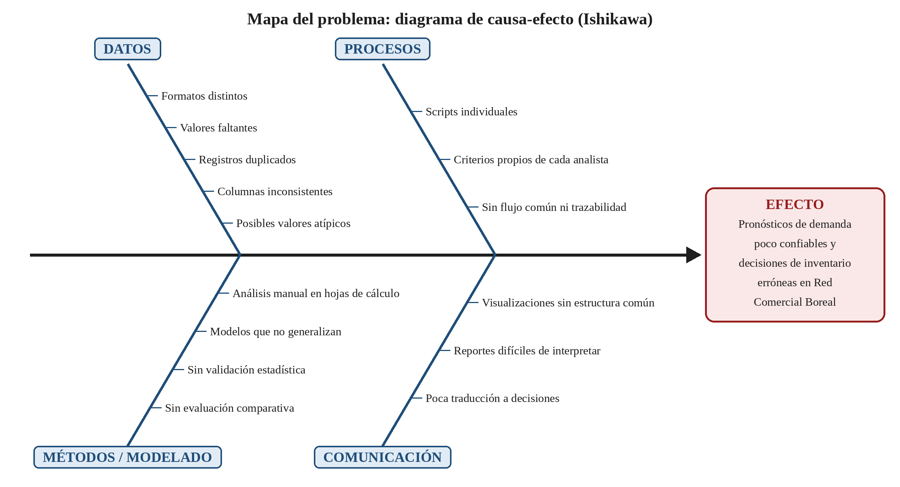

# Diagnóstico del reto analítico y respuesta a la pregunta detonante

**Avance:** 1
**Caso:** Predicciones bajo presión: el desafío analítico de Lúmina Datos Operativos
**Programa:** Maestría en Inteligencia Artificial
**Curso:** Programación para la Inteligencia Artificial (Certificación)
**Alumno:** Kenji Octavio Sashida Goujon
**Matrícula:** AL07340721
**Profesor:** _[Nombre del profesor]_
**Fecha de entrega:** _[Fecha de entrega]_

---

## Introducción

Este documento es el primer avance del proyecto y se desarrolla con la metodología de aprendizaje basado en proyectos. Para elaborarlo asumí el papel de un consultor analítico que, antes de proponer una solución técnica, necesita comprender a fondo una necesidad real de negocio. Trabajé con el caso práctico que proporciona el curso, *Predicciones bajo presión: el desafío analítico de Lúmina Datos Operativos* (Universidad Tecmilenio, s. f.).

Primero respondo de forma argumentada la pregunta detonante del proyecto. Después analizo el caso: su contexto, los datos disponibles, las necesidades, el problema principal, sus consecuencias, los usuarios involucrados y las oportunidades de mejora. Con ese análisis delimito la problemática, justifico su relevancia y presento la evidencia de mi trabajo. Al final incluyo una nota metodológica sobre las herramientas que utilicé.

## 1. Selección del caso

Elegí el caso práctico que proporciona el curso porque plantea una necesidad real y bien acotada. Una consultora analítica tiene que pasar de reportes descriptivos a análisis predictivos con datos desordenados, y está bajo la presión de no perder a un cliente clave. El caso abarca todas las etapas que el proyecto desarrollará a lo largo del curso: limpieza de datos, modularidad, visualización, preprocesamiento, modelado y evaluación.

## 2. Respuesta argumentada a la pregunta detonante

> **¿Cómo puede un framework modular de machine learning en Python transformar datos empresariales desordenados en análisis predictivos confiables para apoyar decisiones estratégicas?**

Un framework modular de machine learning en Python transforma datos desordenados en análisis confiables porque **convierte un trabajo artesanal, que depende de cada persona, en un proceso estandarizado, verificable y repetible**. El problema de Lúmina no es la falta de datos ni de talento. El problema es que cada analista los procesa a su manera, y por eso los resultados no se pueden comparar, repetir ni explicar. Una solución modular ataca esa raíz.

**¿Por qué una solución modular aporta valor?** Un framework modular divide el flujo de trabajo en piezas independientes, cada una con una sola responsabilidad: cargar, limpiar, explorar, preprocesar, modelar, evaluar y reportar. Cada pieza se construye una vez, se prueba y se reutiliza en todos los proyectos. Esto aporta valor a la organización por tres razones:

- **Reduce la improvisación.** Los analistas ya no reescriben el mismo código para cada cliente; usan componentes probados.
- **Permite mejorar por partes.** Si aparece un mejor método para tratar los valores atípicos, se actualiza solo el módulo de limpieza y todo el flujo se beneficia sin tocar lo demás.
- **Facilita el trabajo en equipo.** Todos los analistas hablan el mismo "idioma técnico", y un nuevo integrante puede incorporarse siguiendo un flujo documentado.

**Trazabilidad.** En un flujo modular, cada transformación de los datos ocurre en una función identificable, con parámetros explícitos. Así se puede reconstruir el camino completo: qué datos entraron, cómo se limpiaron, qué registros se eliminaron o imputaron, qué variables se crearon y con qué modelo se generó cada predicción. Cuando Red Comercial Boreal pregunte por qué el modelo recomendó cierta cantidad de inventario, Lúmina podrá responder con evidencia en lugar de suposiciones.

**Reproducibilidad.** Si cualquier analista ejecuta el mismo flujo con los mismos datos y la misma configuración, debe obtener el mismo resultado. Eso es justo lo que hoy falta en Lúmina. Las funciones y clases reutilizables, las semillas aleatorias fijas y la separación ordenada de los datos de entrenamiento y de prueba hacen que un resultado deje de depender de quién lo produjo. La reproducibilidad también permite detectar cuando un modelo funciona bien en un conjunto de datos pero falla en otro, porque la evaluación se aplica siempre con los mismos criterios.

**Interpretación.** Un módulo de visualización y reporte con formatos estandarizados presenta los resultados siempre de la misma manera. Eso hace más fácil que las personas de negocio los entiendan y que se puedan comparar entre periodos o productos. El framework puede generar dos salidas a partir del mismo análisis: una técnica, con métricas y diagnósticos del modelo, y otra ejecutiva, que traduce esas métricas a lenguaje de negocio, como productos en riesgo de desabasto o sucursales con exceso de inventario.

**Utilidad.** La confiabilidad no significa predicciones perfectas; el propio caso aclara que esa no es la prioridad. Significa que las predicciones tienen un margen de error conocido, se validaron con criterios estadísticos y se pueden usar para decidir. Un framework que integra la validación cruzada y la comparación entre modelos permite elegir la mejor alternativa con evidencia y comunicar con honestidad qué tan seguras son sus predicciones. Así, el análisis deja de ser un reporte técnico y se convierte en una herramienta para decidir qué productos priorizar, qué segmentos atender y cómo planear las campañas (Provost y Fawcett, 2013).

En síntesis, el framework modular no hace "magia" con los datos. Impone **orden, rigor y claridad** en cada etapa del análisis, y esa disciplina es la que convierte los datos desordenados en información confiable para decisiones estratégicas.

## 3. Análisis del caso

### 3.1 Contexto general de la organización

Lúmina Datos Operativos es una firma mexicana de consultoría analítica. Apoya a empresas medianas en la interpretación de su información comercial, operativa y de clientes. En sus primeros años se dedicó a hacer **reportes descriptivos** con hojas de cálculo, bases de datos históricas y análisis manuales. Ese enfoque era suficiente cuando los clientes solo querían explicar *qué había ocurrido* con sus ventas o inventarios.

El mercado cambió. Ahora las empresas quieren saber *qué podría ocurrir* y *qué decisiones deberían tomar* antes de que un problema salga caro. Lúmina tiene que dar el salto de la analítica descriptiva a la **analítica predictiva** (Davenport y Harris, 2017), y no tiene los procesos ni las herramientas para hacerlo de forma sólida.

La situación se volvió crítica con **Red Comercial Boreal**, una cadena regional de tiendas y uno de sus clientes principales. Boreal reportó diferencias importantes entre la demanda esperada y la demanda real de varios productos. Algunas sucursales acumularon inventario que no se vendió a tiempo, mientras otras se quedaron sin productos clave en temporadas de alta demanda.

### 3.2 Tipo de datos disponibles o requeridos

| Tipo de dato | Descripción | Uso potencial en el análisis |
|---|---|---|
| Ventas | Unidades e importes vendidos por producto, sucursal y periodo | Variable objetivo para pronosticar la demanda |
| Categorías | Clasificación de los productos | Análisis por categoría y segmentación de productos |
| Precios | Precio de venta por producto y periodo | Variable explicativa de la demanda (sensibilidad al precio) |
| Promociones | Campañas, descuentos y periodos promocionales | Medir el efecto de las promociones en la demanda |
| Comportamiento de compra | Frecuencia, ticket promedio y combinaciones de productos | Segmentación de clientes con modelos no supervisados |
| Variables operativas | Inventarios, abastecimiento y condiciones de las sucursales | Explicar desabastos y excesos de inventario |

**Problemas de calidad identificados en el caso:** la información llega en formatos distintos y tiene valores faltantes, registros duplicados, nombres de columnas inconsistentes y posibles valores atípicos.

**Datos que probablemente se requerirán:** para pronosticar la demanda con más precisión convendría contar con un historial suficientemente largo para captar la estacionalidad, un calendario de temporadas y días festivos, e identificadores de producto y sucursal homologados entre todas las fuentes.

### 3.3 Necesidades actuales

1. **Manejo de datos:** unificar formatos y nombres de columnas, y tratar de forma sistemática los valores faltantes, duplicados y atípicos.
2. **Análisis:** pasar de reportes descriptivos a modelos predictivos (pronóstico de demanda) y de segmentación (clientes y productos), validados estadísticamente.
3. **Estandarización:** contar con un flujo de trabajo común, reproducible y comparable entre analistas y entre conjuntos de datos.
4. **Interpretación:** presentar visualizaciones y reportes con una estructura común, comprensibles para las personas de negocio.
5. **Decisión:** dar a Boreal criterios claros para decidir qué productos priorizar, qué segmentos atender y cómo planear sus campañas.

### 3.4 Problema principal que limita la toma de decisiones

El problema principal es que **Lúmina no tiene un flujo analítico estandarizado y reproducible para convertir los datos desordenados de sus clientes en pronósticos confiables e interpretables**. Cada analista usa sus propios scripts y criterios. Por eso los modelos no son comparables, a veces fallan al aplicarse a otros datos y producen reportes que el negocio no logra entender. Como resultado, Red Comercial Boreal no tiene información confiable para decidir sus inventarios, productos y campañas.

### 3.5 Consecuencias del problema

| Tipo | Consecuencias |
|---|---|
| **Operativas** | Inventario acumulado sin vender en algunas sucursales y desabasto de productos clave en otras; costos de almacenamiento y de reposición urgente |
| **Comerciales** | Ventas perdidas por falta de producto; campañas y promociones mal planeadas; menor satisfacción de los clientes de Boreal |
| **Técnicas** | Resultados que no se pueden reproducir ni comparar; modelos que no generalizan; trabajo duplicado; dependencia del conocimiento de cada analista |
| **Estratégicas** | Pérdida de confianza de un cliente clave; riesgo de que Boreal se vaya con un proveedor con mayor madurez analítica; desventaja de Lúmina frente a la competencia |

### 3.6 Usuarios o áreas involucradas

| Usuario o área | Papel en la problemática | Qué necesita |
|---|---|---|
| **Sofía Aranda**, directora de proyectos analíticos de Lúmina | Impulsa la solución y responde por la relación con el cliente | Un prototipo funcional que demuestre valor y recupere la confianza de Boreal |
| **Equipo de analistas de Lúmina** | Procesan los datos y construyen los modelos | Herramientas comunes, reutilizables y documentadas |
| **Responsables de negocio de Red Comercial Boreal** | Toman las decisiones de inventario, productos y campañas | Resultados claros, confiables y accionables |
| **Sucursales de Boreal** | Sufren directamente el exceso o la falta de inventario | Planeación de abasto ajustada a la demanda real |
| **Áreas de marketing y comercial de Boreal** | Planean las promociones y campañas | Segmentos de clientes y efecto estimado de las promociones |

### 3.7 Oportunidades de mejora mediante Python y machine learning

El caso pide usar pandas (McKinney, 2022), Matplotlib (Hunter, 2007), Seaborn (Waskom, 2021) y scikit-learn (Pedregosa et al., 2011), y organizar la solución en funciones, clases y módulos reutilizables. Con base en eso identifico las siguientes oportunidades, organizadas por etapa del flujo:

| Etapa (módulo) | Oportunidad | Herramientas de Python |
|---|---|---|
| Carga | Leer fuentes en distintos formatos y homologar los nombres de columnas y los tipos de datos | pandas |
| Limpieza | Reglas estándar y documentadas para faltantes, duplicados y atípicos | pandas, NumPy |
| Exploración | Gráficas con un formato común para entender tendencias, estacionalidad y relaciones entre variables | Matplotlib, Seaborn |
| Preprocesamiento | Codificar variables categóricas, escalar y crear variables (por ejemplo, promoción activa o temporada) | scikit-learn (*pipelines*) |
| Modelado supervisado | Pronosticar la demanda por producto y sucursal (regresión, árboles, *random forest*) | scikit-learn |
| Modelado no supervisado | Segmentar clientes y productos (*k-means*) para orientar campañas | scikit-learn |
| Evaluación | Validación cruzada, métricas (MAE, RMSE, R², silueta) y comparación contra un modelo de referencia | scikit-learn |
| Reportes | Una salida técnica y otra ejecutiva generadas a partir del mismo análisis | Matplotlib, pandas |

## 4. Delimitación de la problemática

Lúmina Datos Operativos no puede generar pronósticos de demanda confiables para Red Comercial Boreal. Los datos de ventas, precios, promociones, comportamiento de compra y operación llegan en formatos heterogéneos y con valores faltantes, duplicados, columnas inconsistentes y atípicos, y cada analista los procesa con scripts y criterios propios que no se pueden reproducir ni comparar. Esta falta de un flujo estandarizado de limpieza, preprocesamiento, modelado y evaluación produce modelos que no generalizan entre conjuntos de datos y reportes que los responsables de negocio no logran interpretar. Como consecuencia, Boreal decide mal sus inventarios por producto y sucursal, acumula excedentes en unas tiendas y sufre desabasto en otras. El proyecto atenderá este problema de forma progresiva, mediante una librería modular en Python que estandarice cada etapa del flujo de machine learning.

## 5. Justificación de la relevancia del proyecto

Resolver esta problemática tiene valor para las dos organizaciones y para sus decisiones.

- **Para Red Comercial Boreal**, pronósticos más confiables significan comprar y distribuir el inventario según la demanda esperada de cada producto y sucursal. Eso reduce los costos de almacenamiento y las ventas perdidas por desabasto. La segmentación de clientes le permitirá además orientar mejor sus campañas y promociones.
- **Para Lúmina**, el framework es la base para pasar de la analítica descriptiva a la predictiva, que es lo que el mercado exige. Le permitirá conservar a un cliente estratégico y ofrecer servicios de mayor valor a otros clientes, porque reutilizará la misma librería en cada proyecto.
- **Para la toma de decisiones**, el cambio más importante es que las decisiones se basarán en evidencia trazable y validada, no en análisis aislados o en la intuición. Cuando un directivo pregunte "¿por qué debemos pedir más de este producto?", la respuesta estará respaldada por datos limpios, un modelo evaluado y un margen de error conocido.

El proyecto también es viable. No requiere tecnología costosa, sino herramientas de código abierto (Python y sus librerías) y disciplina metodológica, y se puede construir de forma incremental, módulo por módulo.

## 6. Evidencia de trabajo propio

### 6.1 Notas de análisis

- El caso describe **dos problemas que se refuerzan**: uno de *datos* (calidad e inconsistencia) y otro de *proceso* (falta de estandarización). Aunque los datos se limpiaran, el problema volvería en cada proyecto si el proceso sigue siendo individual.
- Lo que dispara la crisis es un **síntoma operativo** (excesos y faltantes de inventario), pero la causa de fondo es **metodológica**.
- La frase "un modelo puede mostrar buen desempeño en un conjunto de datos, pero fallar cuando se aplica a otro" sugiere **sobreajuste** o falta de validación adecuada. Es un punto que el módulo de evaluación debe atender.
- El caso aclara que "la prioridad no es prometer predicciones perfectas". Por eso el éxito del proyecto se debe medir por su **confiabilidad, trazabilidad y utilidad**, no solo por la precisión del modelo.
- Boreal tiene **tres preguntas de negocio** distintas: qué productos priorizar (pronóstico), qué segmentos atender (segmentación) y cómo planear campañas (efecto de las promociones). Esto justifica que el framework incluya modelos supervisados y no supervisados.
- La **comunicación** es una causa tan importante como la técnica. Un modelo correcto que nadie entiende no sirve para decidir.

### 6.2 Tabla comparativa de necesidades detectadas

| Necesidad | Quién la tiene | Prioridad | Etapa del flujo que la atiende |
|---|---|---|---|
| Datos limpios y homologados | Analistas de Lúmina | Alta | Carga y limpieza |
| Proceso común y reproducible | Lúmina (dirección y analistas) | Alta | Toda la librería modular |
| Pronósticos de demanda confiables | Responsables de negocio y sucursales de Boreal | Alta | Modelado supervisado y evaluación |
| Modelos que generalicen a otros datos | Analistas de Lúmina | Alta | Evaluación (validación cruzada) |
| Reportes comprensibles | Responsables de negocio de Boreal | Media-alta | Visualización y reportes |
| Segmentos de clientes para campañas | Marketing y comercial de Boreal | Media | Modelado no supervisado |
| Recuperar la confianza del cliente | Dirección de Lúmina | Alta (estratégica) | Resultado del proyecto completo |

### 6.3 Mapa del problema

La figura 1 resume en un diagrama de causa-efecto (Ishikawa) las causas que identifiqué, agrupadas en cuatro categorías, y el efecto que producen.

{width=100%}

### 6.4 Registro breve de decisiones

| # | Decisión | Justificación |
|-|----------|----------|
| 1 | Trabajar con el caso práctico del curso (Lúmina) | Plantea una necesidad completa y acotada que abarca todas las etapas del proyecto |
| 2 | Leer el caso en voz alta y grabarlo en Plaud para tener una transcripción de apoyo | Facilitar la revisión del caso y la organización de ideas |
| 3 | Basar el análisis solo en el caso y no en otras fuentes del curso | Mantener el diagnóstico apegado a la información disponible y evitar suposiciones |
| 4 | Organizar las causas en cuatro categorías (datos, procesos, métodos y comunicación) | Distinguir los problemas técnicos de los de proceso y comunicación |
| 5 | Delimitar la problemática al pronóstico de demanda por producto y sucursal | Evitar un problema demasiado amplio y enfocarlo en la necesidad más urgente del cliente |
| 6 | Considerar también la segmentación con modelos no supervisados | Responder a la necesidad de Boreal de saber qué segmentos atender |

### 6.5 Reflexión personal

_[Escribe aquí tu reflexión con tus propias palabras. Ideas que puedes desarrollar: qué te sorprendió del caso; por qué crees que el problema de Lúmina es más de proceso que de tecnología; qué relación ves con situaciones reales que conoces; qué esperas aprender al construir la librería; qué reto anticipas en las siguientes etapas.]_

## 7. Conclusiones

- El problema de Lúmina no es solo técnico. También es **de proceso y de comunicación**: los datos de mala calidad, el trabajo sin estándares y los reportes difíciles de interpretar se refuerzan entre sí y producen pronósticos poco confiables.
- Un framework modular en Python responde a la pregunta detonante porque estandariza el flujo, hace reproducibles y trazables los resultados, y traduce el análisis técnico a información útil para decidir.
- La problemática delimitada, el pronóstico de demanda por producto y sucursal, se puede atender de forma progresiva en las siguientes etapas del proyecto: limpieza, visualización, preprocesamiento, modelado y evaluación.

## 8. Nota metodológica

_[Revisa y ajusta esta nota para que refleje con exactitud cómo hiciste tu trabajo.]_

Para elaborar este avance utilicé las siguientes herramientas digitales:

- **Plaud** (grabadora con transcripción automática): grabé la lectura del caso y la descripción de la actividad para obtener una transcripción y un resumen que me ayudaran a revisar el contenido.
- **Claude** (asistente de inteligencia artificial de Anthropic): lo usé para organizar ideas, proponer una estructura para el documento, apoyar la redacción de borradores, elaborar el diagrama de causa-efecto y dar formato al documento en Word.
- **Microsoft Word**: para la revisión final y la entrega.

Elaboré directamente: _[describe con precisión lo que hiciste tú; por ejemplo, la selección del caso, la lectura y el análisis del caso, la revisión y corrección de cada sección, las decisiones del registro, la reflexión personal y la validación final del contenido]_.

## Referencias

Davenport, T. H., y Harris, J. G. (2017). *Competing on analytics: The new science of winning* (ed. actualizada). Harvard Business Review Press.

Hunter, J. D. (2007). Matplotlib: A 2D graphics environment. *Computing in Science & Engineering, 9*(3), 90–95. https://doi.org/10.1109/MCSE.2007.55

McKinney, W. (2022). *Python for data analysis: Data wrangling with pandas, NumPy, and Jupyter* (3.ª ed.). O'Reilly Media.

Pedregosa, F., Varoquaux, G., Gramfort, A., Michel, V., Thirion, B., Grisel, O., Blondel, M., Prettenhofer, P., Weiss, R., Dubourg, V., Vanderplas, J., Passos, A., Cournapeau, D., Brucher, M., Perrot, M., y Duchesnay, É. (2011). Scikit-learn: Machine learning in Python. *Journal of Machine Learning Research, 12*, 2825–2830.

Provost, F., y Fawcett, T. (2013). *Data science for business: What you need to know about data mining and data-analytic thinking*. O'Reilly Media.

Universidad Tecmilenio. (s. f.). *Predicciones bajo presión: El desafío analítico de Lúmina Datos Operativos* [Caso práctico]. Enseñanza e Investigación Superior, A. C.

Waskom, M. L. (2021). seaborn: Statistical data visualization. *Journal of Open Source Software, 6*(60), 3021. https://doi.org/10.21105/joss.03021
