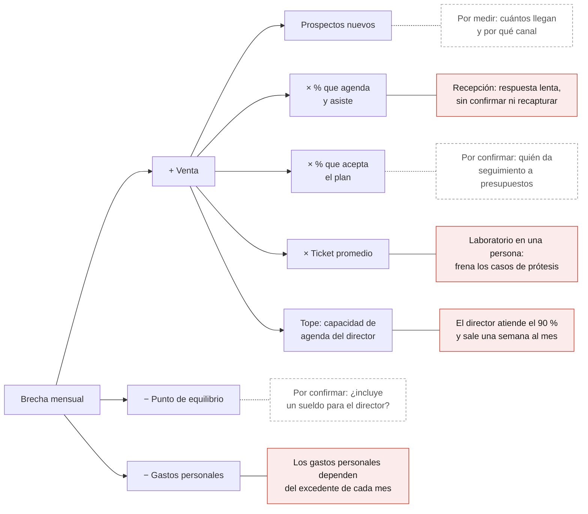

# Diagnóstico empresarial de una clínica dental de especialidades

*Caso de estudio anonimizado · noviembre de 2026 · elaborado con apoyo de IA (Claude)*

> **Nota de anonimización.** Se omiten nombres, ubicación y montos reales. Las cifras se expresan como índice, con el **punto de equilibrio mensual = 100**: una venta de 150 equivale a vender 50 % por encima del punto de equilibrio.

## Resumen

La clínica vende 50 % más que su punto de equilibrio, pero ese excedente no cubre los gastos personales fijos del director. Cada mes falta el equivalente a 25 % del punto de equilibrio, y hasta 40 % con una lectura estricta de los costos variables.

El problema de fondo no es la falta de pacientes. La venta depende de tres personas sin un sistema que las respalde: el director en el sillón, recepción y el laboratorio. La principal es el propio director.

## Contexto del caso

- **Especialidad:** odontología bioestética integral; destacan prótesis dental, implantología y ortodoncia.
- **Equipo:** 7 colaboradores en cuatro áreas: operativa clínica; recepción y administración; laboratorio; y redes sociales, publicidad y ventas.
- **Dirección:** el director toma las decisiones, maneja el dinero (excepto la caja chica) y atiende cerca del 90 % de los pacientes.
- **Ausencias del director:** cursos, congresos y una semana al mes de trabajo fuera de la clínica.
- **Problemas reportados:** flujo insuficiente de pacientes de ticket alto; recepción inestable (respuesta lenta, citas sin confirmar, pacientes sin recaptura); calidad del laboratorio concentrada en una persona de medio tiempo; y dependencia del director.

## Marco de análisis

1. **Finanzas:** punto de equilibrio, margen de contribución y separación entre las finanzas del negocio y las del dueño.
2. **Embudo de pacientes:** del primer mensaje al tratamiento aceptado y la recaptura, con indicadores de gestión de clínicas dentales.
3. **Puntos únicos de falla:** funciones críticas que dependen de una sola persona.
4. **Método ATOMIC** de Oso Trava, del libro *Construye un negocio atómico* (2026): seis palancas de crecimiento (Mentalidad, Oportunidad, Amor, Innovación, Tracción y Capital).
5. **Roles del dueño** según Gerber (1995): técnico, administrador y emprendedor.

## 1. La clínica hoy

Tres de las cinco funciones dependen de una sola persona. La dirección y la clínica dependen del director; la calidad del laboratorio, de una persona de medio tiempo.

| Área | Estado actual | Riesgo | Por qué importa |
|---|---|---|---|
| Operativa clínica (prótesis, implantes, ortodoncia) | El director atiende el 90 % de los pacientes y se ausenta por cursos, congresos y una semana al mes | Crítico | Sin el director casi no hay producción, pero el gasto fijo sigue corriendo |
| Recepción y administración | Tarda en responder mensajes, no confirma todas las citas y no recaptura a quien no se reagendó | Alto | Pierde pacientes cuya atracción ya se pagó |
| Laboratorio | La calidad depende de una persona de medio tiempo | Alto | Sin respaldo, el servicio estrella se detiene |
| Dirección | Decisiones y dinero (sin la caja chica), en el mismo tiempo que la agenda clínica | Alto | Nadie dirige mientras el director atiende o está fuera |
| Redes sociales, publicidad y ventas | Por confirmar: cuántos prospectos genera y cuántos llegan a tratamiento | Medio | Publicidad sin seguimiento rápido es gasto, no inversión |

## 2. Finanzas: la clínica es rentable, pero no sostiene a su director

Con la lectura más simple, cada mes falta el equivalente a 25 % del punto de equilibrio; en un año, tres veces el punto de equilibrio mensual.

| Concepto | Índice (punto de equilibrio = 100) |
|---|---:|
| Venta promedio mensual | 150 |
| − Punto de equilibrio | −100 |
| **= Excedente de la clínica** | **50** |
| − Gastos personales fijos del director | −75 |
| **= Brecha mensual** | **−25** |

En una lectura estricta, cada peso adicional de venta lleva cerca de 30 % de costo variable (materiales, componentes de implante, laboratorio, comisiones). Así, el excedente real ronda 35 y la brecha llega a unos 40.

$$
\text{Venta necesaria} = \text{Punto de equilibrio} + \frac{\text{Gastos personales}}{1 - \text{costo variable}} = 100 + \frac{75}{0.70} \approx 207
$$

Para sostener la clínica y la vida personal del director, la venta debe llegar al menos a 175 en la lectura simple y cerca de 207 en la estricta.

- **La brecha se está pagando con algo:** el trabajo fuera de la clínica, ahorros o deuda. Conviene saber con qué y hasta cuándo.
- **Los gastos personales viven del excedente del mes.** Si el director no se paga un sueldo fijo, un mes flojo de ticket alto se vuelve un mes difícil en casa.

## 3. Mapa de causas

Los problemas comparten una causa: personas sin sistema. En rojo, fallas detectadas; en punteado, datos que faltan.

Recepción frena cuántos prospectos llegan a valoración, y el laboratorio, los casos de prótesis. La agenda del director pone el tope. Cada una de esas tres piezas depende de una sola persona, y ninguna tiene un proceso que la respalde.

## 4. Hallazgo 1: el ticket alto se pierde en el camino, no solo en la entrada

Un implante o una rehabilitación se decide en semanas y pasa por seis etapas. Hoy fallan al menos tres: la respuesta, la confirmación y la recaptura.

| Etapa | Quién la lleva hoy | Fuga | Qué medir |
|---|---|---|---|
| 1. Primer mensaje o llamada | Recepción | Respuesta tardía: el prospecto ya le escribió a otras clínicas | Minutos a la primera respuesta |
| 2. Cita de valoración | Recepción | No se agenda en el primer contacto | % de prospectos que agendan |
| 3. Asistencia | Recepción | Citas sin confirmar terminan en inasistencias y huecos en la agenda | % de citas confirmadas e inasistencias |
| 4. Diagnóstico y plan | Director | Por confirmar: si el plan se entrega con opciones de pago y una cita para decidir | % de planes aceptados, por monto |
| 5. Seguimiento del presupuesto | Por definir | Un presupuesto sin llamada se enfría en días | Monto pendiente con próximo contacto agendado |
| 6. Recaptura y referidos | Recepción | Nadie busca a quien no se reagendó | Pacientes recuperados al mes |

- **Más publicidad sobre un embudo roto solo encarece cada paciente.** Primero se arreglan las etapas 1 a 3; después se invierte más en atraer.
- **El paciente de ticket alto más barato ya está en la base de datos.** Presupuestos no aceptados y pacientes inactivos cuestan horas de seguimiento, no publicidad.
- **El ingreso recurrente debe pagar la operación; el ticket alto, la utilidad.** Las mensualidades de ortodoncia y los mantenimientos son predecibles, mientras implantes y prótesis llegan por rachas. Conviene saber qué parte de la venta es cada cosa.
- **La venta de alto valor necesita a alguien que no sea el director.** Una coordinación de tratamientos explica el plan, ofrece opciones de pago (meses sin intereses, pagos programados) y llama a quien no decidió.

## 5. Hallazgo 2: recepción es el primer vendedor y opera sin sistema

Cada mensaje tardío, cita sin confirmar o paciente sin recaptura es venta que ya se pagó con publicidad y se pierde en la puerta. La inestabilidad del puesto apunta a la causa: el trabajo vive en la persona, no en un proceso escrito.

- **Nadie es dueño del prospecto completo.** Redes atrae y recepción responde; entre las dos áreas, el paciente se enfría.
- **El puesto mezcla atención, agenda y administración.** Sin estándares ni tablero, el paciente en mostrador le gana siempre al mensaje del prospecto.
- **El puesto no tiene memoria.** Cuando cambia la persona, se van con ella los guiones, los pendientes y la lista de pacientes por recapturar.

| Proceso | Estándar propuesto | Herramienta |
|---|---|---|
| Responder mensajes | Menos de 15 minutos en horario (ideal: 5) y mensaje automático fuera de horario | WhatsApp Business con respuestas rápidas y etiquetas |
| Confirmar citas | Dos avisos, 48 y 24 horas antes, y lista de espera para cubrir huecos | Recordatorios automáticos del software de agenda |
| Recapturar pacientes | Lista diaria de pacientes sin próxima cita, con meta de contactos por día | Reporte del software de agenda |
| Dar seguimiento a presupuestos | Llamadas a los 2, 7 y 30 días de entregado el plan | Etiquetas por etapa o un CRM sencillo |
| Atender igual siempre | Guiones para precio, valoración, financiamiento y objeciones | Manual del puesto |
| Medir | Respuesta, confirmación, asistencia y recapturas, revisados cada lunes | Hoja compartida o reporte del software |

Una prueba sencilla: con el manual, una persona nueva debería operar el puesto en una semana. Parte del sueldo de recepción puede ser variable, ligada a citas asistidas y tratamientos iniciados.

## 6. Hallazgo 3: el servicio estrella depende de una persona de medio tiempo

El laboratorio propio es la mayor ventaja de la clínica en prótesis y su mayor riesgo operativo. Si esa persona falta, se detienen las entregas, y con ellas el cobro.

- **Capacidad.** El medio tiempo pone un techo a cuántos casos de prótesis se pueden vender y entregar al mes.
- **Continuidad.** Una incapacidad, unas vacaciones o una renuncia detienen la línea de mayor valor sin plan B.
- **Flujo de efectivo.** Si el saldo se cobra al entregar, cada retraso del laboratorio retrasa el ingreso.
- **Calidad sin estándar escrito.** La calidad vive en las manos de una persona, no en un protocolo que otra pueda seguir.

Lo que convierte al laboratorio en sistema:

- Protocolos por tipo de trabajo (corona, puente, prótesis total, sobre implantes, retenedores), con tiempos de entrega y criterios de aceptación.
- Un laboratorio externo de respaldo, probado con dos o tres casos antes de necesitarlo.
- Tres números al mes: días de entrega, porcentaje de repeticiones y costo por unidad propio frente al externo.
- Un esquema de pago ligado a la carga real: pago por unidad entregada o más horas cuando haya más casos.
- A mediano plazo, evaluar el flujo digital (escáner intraoral y diseño digital), que reduce la dependencia de una sola mano.

La pregunta de dueño no es si el laboratorio es bueno, sino si seguiría siéndolo sin esa persona.

## 7. Hallazgo 4: la clínica depende del sillón y de la agenda del director

La agenda del director es el techo de la clínica: produce cerca del 90 %, dirige y maneja el dinero. Cuando sale, la producción casi se detiene y el gasto sigue: cada semana corre casi una cuarta parte del punto de equilibrio.

En términos de Gerber (1995), el director ejerce a la vez de técnico, administrador y emprendedor, y el técnico consume el tiempo de los otros dos.

- **Las ausencias son parte de la estructura, no excepciones.** Una semana al mes fuera es casi la cuarta parte del mes. Con cursos y congresos, la clínica pasa todavía más tiempo sin su principal productor.
- **Hoy no hay un negocio que pague al director: hay un empleo que además administra.** Si un especialista asociado hiciera el 90 % de la producción por una comisión de 30 % (supuesto ilustrativo), costaría unos 40 puntos del índice al mes. El excedente de la clínica bajaría de 50 a unos 10.
- **El tiempo de dueño es el que sobra del sillón.** Los números, el equipo y las ventas quedan para después de consulta; por eso recepción y laboratorio siguen sin sistema.
- **La semana de trabajo externo merece una decisión con números.** Conviene comparar lo que deja por día contra lo que el director produce en su clínica por día, menos costos variables. Si es el puente para cubrir la brecha, necesita fecha de salida ligada a una meta de venta.

**Qué conservar y qué delegar.** El director conserva el diagnóstico y el plan de casos complejos, la cirugía de implantes y la rehabilitación. Delega valoraciones iniciales, profilaxis, mantenimientos, resinas, ajustes y controles de ortodoncia a un odontólogo asociado por comisión, con protocolos y supervisión.

**Meta a 12 meses:** bajar la parte de la producción del director del 90 % a 60–70 %, con su sillón concentrado en ticket alto y sus ausencias planeadas por semestre.

## 8. Lectura con el método ATOMIC

Con las seis palancas de *Construye un negocio atómico*, la clínica es fuerte en Oportunidad e Innovación y débil en Mentalidad, Amor y Tracción. El modelo arranca por la Mentalidad, y en este caso ahí empieza el cambio.

| Palanca | Qué evalúa | La clínica hoy | Lectura |
|---|---|---|---|
| Mentalidad | Pensar como dueño, no como el mejor empleado | El tiempo de dueño es el que sobra del sillón | Débil |
| Oportunidad | Un mercado con un problema claro y dispuesto a pagar | Prótesis, implantes y ortodoncia: tratamientos de alto valor con demanda constante | Fuerte |
| Amor (ventas y marketing) | Cómo se atrae, atiende y convierte al paciente | Respuesta lenta, citas sin confirmar y pacientes sin recaptura | Débil |
| Innovación | Una propuesta difícil de copiar | Odontología bioestética integral con laboratorio propio, aunque este depende de una persona | Fuerte |
| Tracción | Crecimiento que se repite con procesos y métricas | Sin tablero; el crecimiento depende de la agenda del director | Débil |
| Capital | Los números que detonan el crecimiento | Se conoce el punto de equilibrio, pero los gastos personales dependen del excedente de cada mes | Media |

La palanca que mueve a las demás es la Mentalidad. Mientras la agenda del director sea la del mejor clínico de la clínica y no la de su dueño, no habrá tiempo para construir Amor, Tracción ni Capital. Su primer acto de dueño es comprar su propio tiempo: delegar lo que no requiere sus manos para dirigir lo que sí requiere su cabeza.

*Las palancas y su orden vienen de descripciones públicas del libro; la evaluación de cada una es de este diagnóstico.*

## 9. Prioridades y ruta de 90 días

Primero se cobra la demanda que ya existe y se ordenan los números; después se reduce la dependencia de tres personas.

| # | Frente | Cuándo | Qué incluye |
|---|---|---|---|
| 1 | Números separados y sueldo fijo del director | Mes 1 | Cuentas separadas, sueldo fijo y estado de resultados mensual |
| 2 | Recepción con sistema | Mes 1 | Estándares de respuesta, confirmación automática, recaptura diaria, guiones y tablero semanal |
| 3 | Seguimiento de presupuestos | Meses 1–2 | Lista de planes no aceptados, llamadas programadas, opciones de pago y coordinación de tratamientos |
| 4 | Respaldo del laboratorio | Meses 1–3 | Protocolos escritos, laboratorio externo probado y costo por unidad comparado |
| 5 | Menos dependencia del director | Meses 2–12 | Odontólogo asociado por comisión, ausencias planeadas y decisión sobre el trabajo externo |
| — | **Revisión de 90 días** | **Día 90** | ¿Venta de al menos 175? ¿Recepción en estándar? |

Los frentes 1 a 3 cobran demanda que ya se pagó y deberían mover la venta antes del día 90. El frente 5 cambia la estructura y toma un año.

### Primera semana

- [ ] Sacar la venta de los últimos 12 meses, mes por mes, separando recurrente y ticket alto.
- [ ] Listar los presupuestos no aceptados de los últimos 6 meses, con monto y teléfono.
- [ ] Medir una semana de recepción: minutos de respuesta, citas confirmadas e inasistencias.
- [ ] Definir el sueldo fijo del director y separar las cuentas de la clínica de las personales.
- [ ] Pedir a dos laboratorios externos un caso de prueba.
- [ ] Bloquear en el calendario los cursos, congresos y semanas fuera de los próximos 6 meses.

## 10. Tablero de indicadores

Diez números, revisados cada lunes en 30 minutos, bastan para dirigir la clínica sin estar en cada detalle. Las metas son propuestas; las primeras cuatro semanas sirven para medir la línea base.

| Indicador | Meta propuesta | Frecuencia | Responsable |
|---|---|---|---|
| Venta cobrada del mes frente a la necesaria | Al menos 175; después 207 (índice) | Semanal | Director |
| Excedente después del sueldo del director | Positivo todos los meses | Mensual | Director |
| Prospectos nuevos y % que agenda valoración | Línea base en 4 semanas, luego subir | Semanal | Redes y ventas |
| Minutos a la primera respuesta | Menos de 15 en horario | Diaria | Recepción |
| Citas confirmadas e inasistencias | 100 % confirmadas; inasistencia menor a 10 % | Diaria | Recepción |
| Planes aceptados, por monto | Línea base en 4 semanas, luego subir | Mensual | Coordinación de tratamientos |
| Presupuestos pendientes con próxima llamada | 100 % con fecha | Semanal | Coordinación de tratamientos |
| Pacientes recapturados | Línea base en 4 semanas, luego subir | Semanal | Recepción |
| Parte de la producción hecha por el director | De 90 % a 60–70 % en 12 meses | Mensual | Director |
| Entregas y repeticiones de laboratorio | Entrega en el plazo del protocolo; repeticiones menores a 5 % | Mensual | Laboratorio |

## 11. Datos que faltan para afinar el diagnóstico

| Dato que falta | Qué cambia |
|---|---|
| ¿El punto de equilibrio incluye un sueldo para el director? ¿Los gastos personales son del director o la nómina del equipo? | La brecha real y la venta necesaria |
| Venta de los últimos 12 meses, mes por mes, separada en recurrente y ticket alto | Qué tan estable es el flujo y cuánto cubre la base recurrente |
| Prospectos, valoraciones, planes presentados y planes aceptados del último mes | En qué etapa está la mayor fuga |
| Inversión mensual en publicidad | Cuánto cuesta cada paciente nuevo |
| Días al mes fuera de la clínica y lo que deja el trabajo externo | Si conviene seguir, y hasta cuándo |
| Costo por unidad del laboratorio propio frente a uno externo | Si el laboratorio es una ventaja o solo una costumbre |
| Quién atiende el 10 % restante y con qué esquema de pago | Qué tan rápido se puede delegar |
| Cuántas personas han pasado por recepción en el último año | Si el problema es de la persona, del puesto o del sueldo |

El cuestionario completo, por área y con prioridades, está en [cuestionario-diagnostico-clinica-dental.md](cuestionario-diagnostico-clinica-dental.md).

## Referencias

- Gerber, M. E. (1995). *The E-Myth Revisited: Why Most Small Businesses Don't Work and What to Do About It*. HarperCollins. En español: *El mito del emprendedor*.
- Trava, O. (2026). *Construye un negocio atómico: Manual práctico para el emprendedor e intraemprendedor crack*. Penguin Random House. [Ficha del libro](https://www.amazon.com/Construye-negocio-at%C3%B3mico-emprendedor-intraemprendedor-ebook/dp/B0HLQWF16H).
- Penguin Libros. [Oso Trava, página de autor](https://www.penguinlibros.com/es/205086-oso-trava).
- El Financiero (26 de septiembre de 2023). [Business Masters Live, la "maestría" de tres días para lograr un crecimiento atómico de tu negocio](https://www.elfinanciero.com.mx/mundo-empresa/2023/09/26/business-masters-live-la-maestria-de-tres-dias-para-lograr-un-crecimiento-atomico-de-tu-negocio/).

*El método ATOMIC se resume a partir de descripciones públicas del libro, consultadas por buscador; no se revisó el texto completo. Los datos del caso fueron proporcionados por la dirección de la clínica.*
